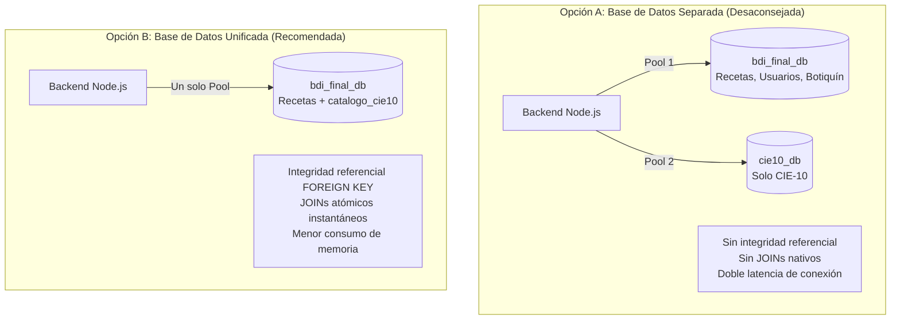
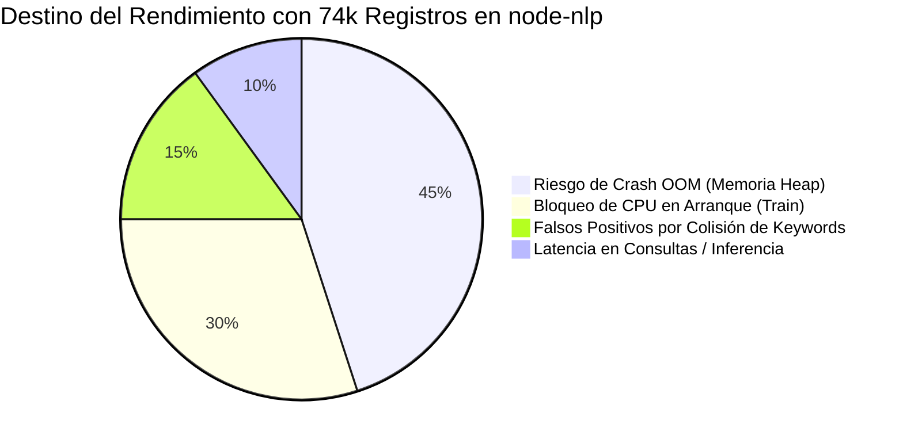

# Análisis de Arquitectura: Separación de Base de Datos CIE-10 y Viabilidad en Node-NLP

---

## 1. ¿Es realmente recomendable separar los códigos CIE-10 en una base de datos independiente?

### Respuesta Directa: **NO**

A nivel de arquitectura de software e ingeniería de datos, **no es recomendable** separar el catálogo CIE-10 en una base de datos independiente si se mantendrá dentro del mismo paradigma relacional (MySQL). Lo ideal y óptimo para el proyecto es **mantenerlo como una tabla de catálogo (`catalogo_cie10`) dentro de la base de datos principal (`bdi_final_db`)**.

---

### Análisis Comparativo de Arquitectura



### Razones Técnicas Fundamentales

| Criterio | Mantener en la Misma BD (`catalogo_cie10`) | Separar en Otra BD (`cie10_db`) | Justificación Técnica |
| :--- | :--- | :--- | :--- |
| **Volumen de Datos** | **Óptimo** (~50 a 80 MB) | **Injustificado** | 74,260 registros es un volumen **pequeño** para motores relacionales como MySQL. Tablas con millones de filas operan sin problemas en una sola BD. |
| **Integridad Referencial** | **Nativa (`FOREIGN KEY`)** | **Inexistente** | `recetas.codigo_cie10` puede vincularse y validarse automáticamente en el motor relacional. En bases separadas, la consistencia debe gestionarse manualmente en código. |
| **Consultas (`JOINs`)** | **Directos y en microsegundos** | **Joins manuales en memoria** | Con una sola base de datos puedes hacer `SELECT r.*, c.termino_medico FROM recetas r JOIN catalogo_cie10 c ON ...`. Con bases separadas tendrías que hacer dos consultas HTTP/TCP y cruzarlas en Node.js. |
| **Conexiones Backend** | **1 Connection Pool** | **2 Connection Pools** | Cada pool en Node.js consume descriptores de archivo, sockets y memoria. Si la base de datos se despliega en cualquier host con límites de conexión, se corre el riesgo de agotarlas rápidamente. |
| **Transacciones ACID** | **Transacciones Atómicas** | **Transacciones Distribuidas** | Si al registrar una receta necesitas validar o actualizar estados con transacciones (`START TRANSACTION`), entre dos bases de datos se requiere lógica compleja de coordinación (como 2-Phase Commit). |

> [!NOTE]
> **¿Cuándo sí se justifica una base de datos separada?**
> Solo se justificaría si:
> 1. El catálogo CIE-10 fuera un **microservicio corporativo compartido** consumido por decenas de aplicaciones hospitalarias distintas.
> 2. Se usara un motor de datos **especializado de diferente naturaleza** (por ejemplo, una base de datos vectorial como Qdrant/Pinecone para embeddings o un motor de búsqueda como Meilisearch/Typesense/Elasticsearch). Pero separar un MySQL para ponerlo en otro MySQL solo añade fricción sin aportar beneficios.

---

## 2. ¿Cómo afecta o afectarían los 74,260 registros al motor `node-nlp`?

En la implementación actual (`server/src/services/nlpService.js`), el servidor ejecuta lo siguiente al iniciar:

```javascript
// server/src/services/nlpService.js
const [diagnosticos] = await pool.query('SELECT codigo_cie10, keywords FROM catalogo_cie10');

diagnosticos.forEach((diag) => {
  const idEntidad = diag.codigo_cie10;
  // Agrega al motor NER de node-nlp cada entidad con sus keywords
  manager.addNamedEntityText(idEntidad, idEntidad, ['es'], keywords);
});

await manager.train(); // Entrena el modelo en memoria RAM
```

Si se introducen los **74,260 registros** generados en `CIE-10/Generados_SQL`, el impacto sobre el motor `node-nlp` y el backend es **crítico**.

---

### Diagnóstico de Impacto: Problemas Detectados

#### 1. Explosión de Términos en Memoria (Tokens)
* **Cálculo de volumen:**
  $$\text{Total Reglas NER} \approx 74,260 \text{ códigos} \times 12 \text{ sinónimos/keywords promedio} \approx 890,000 \text{ a } 1,100,000 \text{ términos}$$
* Para cada uno de esos ~1,000,000 de términos, `node-nlp` crea nodos en un árbol de búsqueda (*Trie*) y diccionarios de extracción de entidades nombradas en memoria RAM del proceso Node.js.

#### 2. Colapso de Memoria RAM (`JavaScript heap out of memory`)
* El motor V8 de Node.js tiene un límite predeterminado de memoria heap de 1.4 GB a 2 GB (y en contenedores o servidores cloud suele limitarse a 512 MB o 1 GB).
* Construir las matrices de similitud y el árbol léxico para 74,260 clases provocará de manera casi segura:
  ```text
  FATAL ERROR: Ineffective mark-compacts near heap limit Allocation failed - JavaScript heap out of memory
  ```
  El proceso del servidor morirá antes de que Express pueda comenzar a escuchar en el puerto.

#### 3. Tiempo de Arranque del Servidor Excesivo (`manager.train()`)
* Con 20 a 50 registros de prueba, `node-nlp` entrena en 1 a 2 segundos.
* Con 74,260 entidades y un millón de keywords, la fase de entrenamiento requerirá calcular probabilidades y pesos para cada clase. Esto tomaría **entre 15 y 45 minutos** de procesamiento continuo de CPU cada vez que el servidor se reinicia o se despliega.

#### 4. Latencia de Inferencia Bloqueante (Event Loop de Node.js)
* Cada vez que un usuario envíe una frase de síntomas a `/api/symptoms/analyze`, la función `manager.process('es', frase)` comparará el texto de entrada contra los 74,260 patrones en memoria.
* Como JavaScript ejecuta en un solo hilo (*Single Thread Event Loop*), una inferencia tan pesada congelará el servidor durante segundos, bloqueando las peticiones de todos los demás usuarios (recetas, login, botiquín).

#### 5. Colisiones Masivas y Pérdida de Precisión (Falsos Positivos)
* Las keywords generadas por IA contienen síntomas y coloquialismos comunes (ej. *"dolor"*, *"ardor"*, *"inflamación"*, *"fiebre"*, *"molestia"*, *"sangrado"*).
* Estos términos aparecen repetidos en cientos o miles de enfermedades distintas del CIE-10.
* Al escribir una frase como: *"me duele la cabeza y tengo ardor de garganta"*, el reconocedor NER activará simultáneamente **decenas o cientos de entidades `codigo_cie10`**, saturando el filtro de relevancia y devolviendo sugerencias no relacionadas.

---

## 3. Resumen de Impacto en `node-nlp`



| Métrica / Factor | Con Catálogo Demo (~50 códigos) | Con Catálogo Completo (74,260 códigos) |
| :--- | :--- | :--- |
| **Tiempo de arranque (`train`)** | ~1 - 2 segundos | **15 - 45+ minutos** (o crash) |
| **Consumo de Memoria RAM** | ~70 - 100 MB | **> 1.5 - 2.5 GB** |
| **Riesgo de `Heap Out Of Memory`** | Nulo | **Muy Alto** |
| **Latencia por consulta de síntoma** | < 50 ms | **> 1,500 - 4,000 ms** (bloqueante) |
| **Precisión del NER** | Alta (entidades delimitadas) | **Baja (alta tasa de colisión léxica)** |

---

## 4. Alternativas de Arquitectura Recomendadas

Para aprovechar al máximo los 74,260 códigos sin saturar la memoria de Node.js, existen tres estrategias viables:

### Opción 1: Búsqueda Indexada en MySQL Full-Text + LLM (La más limpia y escalable)
1. Los 74,260 registros se guardan en la tabla `catalogo_cie10`.
2. Se añade un índice `FULLTEXT` en MySQL sobre `termino_medico` y `keywords`:
   ```sql
   ALTER TABLE catalogo_cie10 ADD FULLTEXT idx_busqueda_medica (termino_medico, keywords);
   ```
3. Cuando el usuario dicta o escribe sus síntomas:
   * **Gemini / Groq** (que ya están integrados en el backend) extrae los términos clave y sospechas clínicas principales en 300 ms.
   * Con esos términos se hace una consulta SQL rápida:
     ```sql
     SELECT codigo_cie10, termino_medico, MATCH(termino_medico, keywords) AGAINST(? IN NATURAL LANGUAGE MODE) AS relevancia
     FROM catalogo_cie10
     WHERE MATCH(termino_medico, keywords) AGAINST(? IN NATURAL LANGUAGE MODE)
     ORDER BY relevancia DESC LIMIT 10;
     ```
* **Ventaja:** Cero sobrecarga de RAM en Node.js, arranque del servidor instantáneo y respuestas en < 100 ms.

### Opción 2: Modelo Jerárquico o Híbrido en `node-nlp`
* Entrenar `node-nlp` **únicamente con los diagnósticos más frecuentes en atención primaria y medicina general** (un subconjunto de 300 a 500 enfermedades comunes: faringitis, hipertensión, diabetes, migraña, gastroenteritis, etc.).
* Si `node-nlp` no detecta una entidad dentro del subconjunto frecuente, el sistema recurre a la búsqueda en la base de datos completa.

### Opción 3: Pre-entrenar y persistir el modelo (`model.nlp`)
* En lugar de llamar a `manager.train()` cada vez que arranca el servidor, el entrenamiento se realiza una sola vez en un script aislado (`npm run train:nlp`) y se guarda en un archivo binario/JSON `model.nlp`.
* Al iniciar `server.js`, solo se hace `manager.load('model.nlp')` sin re-entrenar.
*(Nota: Aunque evita el tiempo de entrenamiento al inicio, sigue teniendo el problema del consumo de RAM y colisión de keywords).*
