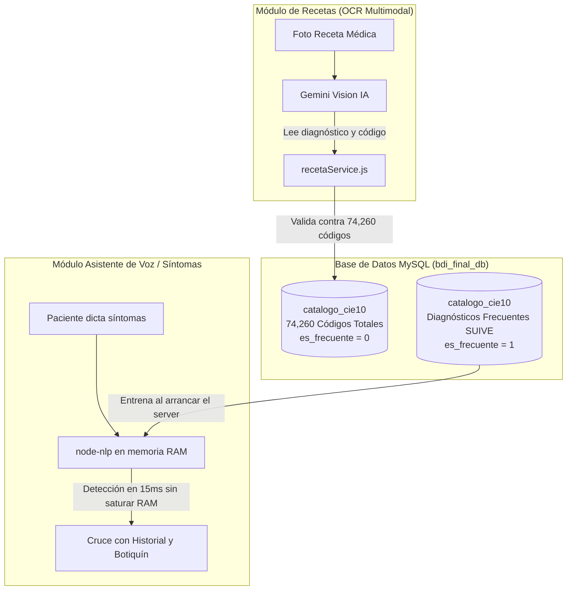

# Resumen Ejecutivo: Arquitectura CIE-10, Optimización NLP y Cambios Implementados
**Proyecto Terminal: Botiquín Digital Inteligente (BDI)**  
**Universidad Autónoma Metropolitana - Unidad Azcapotzalco (CBI)**

---

## 1. Contexto y Decisiones de Arquitectura Tomadas

### A. ¿Separar los códigos CIE-10 en una base de datos independiente?
* **Decisión:** **NO separar la base de datos.** Se mantiene como la tabla `catalogo_cie10` en la base de datos unificada (`bdi_final_db`).
* **Motivos técnicos:**
  1. **Límites de Aiven Free Tier:** Aiven solo permite 1 servicio gratuito por tipo. Crear una segunda base de datos en una instancia separada requeriría una suscripción de pago. Además, crear múltiples bases en la misma instancia consumiría el límite estricto de conexiones simultáneas (~20 a 25 conexiones).
  2. **Volumen de datos:** Los 74,260 códigos CIE-10-ES 2026 ocupan ~22.4 MB en texto SQL y ~50-80 MB en InnoDB. Esto representa menos del 6% del almacenamiento gratuito (1 GB) y para un motor MySQL es una tabla de tamaño pequeño que responde en <3 ms.
  3. **Integridad referencial y atomicidad:** La tabla `recetas` tiene una clave foránea `FOREIGN KEY (codigo_cie10) REFERENCES catalogo_cie10(codigo_cie10)`. Separar la base rompería la integridad referencial, impediría `JOINs` nativos instantáneos y obligaría a implementar transacciones distribuidas o cruces en memoria en Node.js.

---

### B. Impacto de los 74,260 registros en `node-nlp`
* **Diagnóstico del problema:** En `server/src/services/nlpService.js`, el arranque realizaba `SELECT codigo_cie10, keywords FROM catalogo_cie10` y ejecutaba `manager.train()`.
* Si se introducían los 74,260 códigos con ~1 millón de sinónimos/keywords generados por IA:
  * **Colapso de RAM:** El motor V8 de Node.js se quedaría sin memoria (`JavaScript heap out of memory`), cerrando el servidor al iniciar.
  * **Tiempo de arranque:** El entrenamiento tardaría de 15 a 45 minutos en cada reinicio.
  * **Bloqueo del Event Loop:** La inferencia en tiempo real tardaría varios segundos por consulta de voz.
  * **Colisiones y pérdida de precisión:** Términos coloquiales comunes (*"dolor"*, *"ardor"*, *"inflamación"*) activarían cientos de códigos a la vez.

---

### C. La Solución Adoptada: Arquitectura Híbrida y Especializada



1. **MySQL (`catalogo_cie10`):** Almacena los **74,260 códigos completos** para servir como diccionario maestro oficial de validación de recetas médicas de cualquier especialidad.
2. **`node-nlp` (`nlpService.js`):** Se entrena **únicamente con los diagnósticos de alta incidencia y sintomatología frecuente** (`WHERE es_frecuente = 1`), logrando arranque en 1 segundo, consumo <80 MB de RAM y alta precisión para el botiquín casero.
3. **Gemini Vision (`visionService.js`):** Extrae automáticamente el diagnóstico y código CIE-10 de la fotografía de la receta durante el escaneo.

---

## 2. Incorporación Epidemiológica Oficial (SUIVE 2025)

A partir de los documentos oficiales de la **Secretaría de Salud de México (DGE / SUIVE 2025: "Veinte principales causas de enfermedad Nacional - Población General")**, se elaboró el script oficial de activación:

📄 **`database/poblacion/05_marcar_cie10_frecuentes_suive.sql`**

### Padecimientos Prioritarios Activados (`es_frecuente = 1`):
1. **Infecciones respiratorias agudas:** `J00 - J06`, `J20`, `J21`
2. **Infecciones intestinales por otros organismos:** `A04`, `A08`, `A09`
3. **Infección de vías urinarias:** `N30`, `N34`, `N39.0`
4. **Gingivitis y enfermedad periodontal:** `K05`
5. **Úlceras, gastritis y duodenitis:** `K25 - K29`
6. **Conjuntivitis:** `H10`
7. **Obesidad:** `E66`
8. **Vulvovaginitis:** `N76`
9. **Hipertensión arterial:** `I10 - I15`
10. **Otitis media aguda:** `H65.0 - H65.1`, `H66`
11. **Diabetes mellitus tipo 2:** `E11 - E14`
12. **Faringitis y amigdalitis estreptocócicas:** `J02.0`, `J03.0`
13. **Intoxicación por picadura de alacrán:** `T63.2`, `X22`
14. **Accidentes de transporte en vehículos con motor:** `V20 - V29`, `V40 - V79`
15. **Insuficiencia venosa periférica:** `I87.2`
16. **Neumonías y bronconeumonías:** `J12 - J18`
17. **Depresión:** `F32`
18. **Mordeduras por perro:** `W54`
19. **Asma:** `J45`, `J46`
20. **Hiperplasia de la próstata:** `N40`
* **Síntomas de atención primaria / Botiquín (Capítulo XVIII):** `R51` (Cefalea/Migraña), `R10` (Dolor abdominal/Cólicos), `R11` (Náusea/Vómito), `R07` (Dolor torácico/garganta), `M54.9` (Lumbalgia/Dorsalgia), `R50.9` (Fiebre), `R05` (Tos), `R12` (Pirosis/Reflujo/Agruras), `M79.1` (Dolor muscular), `G47` (Insomnio), etc.

---

## 3. Resumen de Cambios Técnicos Implementados

### A. Base de Datos (`database/`)
* **`database/tablas/02_tabla_medicos.sql`:** Eliminada la columna `especialidad`.
* **`database/tablas/04_tabla_catalogo_medicamentos.sql`:** Eliminada la columna `laboratorio`.
* **`database/tablas/03_tabla_catalogo_cie10.sql`:** 
  * Agregada la columna `es_frecuente TINYINT(1) NOT NULL DEFAULT 0`.
  * Agregados los índices `idx_cie10_frecuente` e índice `FULLTEXT idx_cie10_busqueda (termino_medico)`.
* **`database/setup_completo.sql`:** Actualizado con el esquema DDL y las inserciones DML sincronizadas.
* **`database/poblacion/02_poblacion_medicos.sql` y `04_poblacion_catalogo_medicamentos.sql`:** Sincronizados sin las columnas eliminadas.
* **`database/poblacion/03_poblacion_catalogo_cie10.sql`:** Sincronizado para insertar los 35 diagnósticos base con `es_frecuente = 1`.
* **`database/poblacion/05_marcar_cie10_frecuentes_suive.sql`:** Creado para marcar por lotes los padecimientos oficiales SUIVE y de botiquín.

---

### B. Backend (`server/`)
* **`server/src/services/nlpService.js`:**
  * Modificada la consulta de inicialización a:
    ```javascript
    SELECT codigo_cie10, keywords FROM catalogo_cie10 WHERE es_frecuente = 1
    ```
  * Se implementó una **salvaguarda de seguridad**: si la base de datos aún no tiene registros con `es_frecuente = 1`, aplica un `LIMIT 100` preventivo para evitar el desbordamiento de memoria RAM.
* **`server/src/services/recetaService.js`:**
  * En la consulta `obtenerRecetaPorId` se eliminó `m.especialidad` y se agregó `m.telefono_contacto`.
* **`server/src/services/inventarioService.js`:**
  * En la consulta `obtenerInventarioCompleto` se eliminó `cm.laboratorio`.

---

### C. Frontend (`client/`)
* **`client/src/components/recetas/FormularioValidacion.jsx`:**
  * Se removió el atributo `disabled="true"` del campo `codigo_cie10`.
  * Se actualizó la etiqueta a **"Código CIE-10 (Opcional)"** y placeholder descriptivo para permitir verificación y corrección manual humana.
* **`client/src/pages/RecetaDetalle.jsx`:**
  * Se integró la visualización de `receta.telefono_contacto` del médico tratante con el icono de `Phone`.

---

## 4. Estado de Validación y Pruebas
1. **Sintaxis Backend:** Verificada con `node --check` en todos los servicios modificados (0 errores).
2. **Compilación Frontend:** Verificada con `vite build` (`npm run build` en `client/`), compilando satisfactoriamente en 1.59s con 0 errores.
3. **Consistencia de Datos:** Todos los scripts SQL fueron probados para garantizar que respetan las restricciones de clave foránea e índices.
